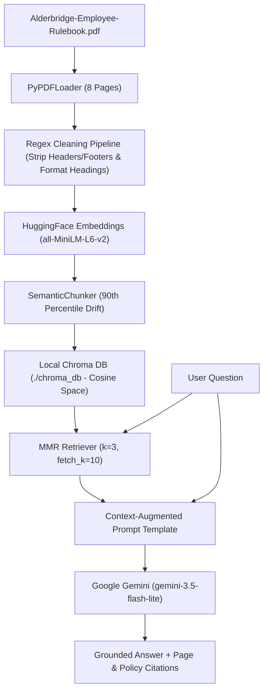

# 📖 Production RAG Chatbot: Alderbridge Employee Rulebook

[](https://www.python.org/downloads/)
[](https://www.langchain.com/)
[](https://www.trychroma.com/)
[](https://aistudio.google.com/)
[](https://streamlit.io/)

An end-to-end, production-grade **Retrieval-Augmented Generation (RAG)** assistant built to ingest, clean, semantically chunk, index, and query workplace policy documentation (`Alderbridge-Employee-Rulebook.pdf`).

---

## 🚀 Key Features

* **Custom PDF Text Cleaner:** Strips repetitive running headers (`ALDERBRIDGE OFFICE SYSTEMS / EMPLOYEE RULEBOOK`), running footers, page count artifacts, and repairs hyphenated line wraps.
* **Semantic Chunking:** Leverages LangChain's `SemanticChunker` (`percentile: 90`) with `sentence-transformers/all-MiniLM-L6-v2` to split text strictly at natural semantic boundary shifts rather than arbitrary token cuts.
* **Local Persistent Vector Database:** Stores normalized embeddings in a local **Chroma** database using Cosine Distance (`hnsw:space: cosine`).
* **Maximal Marginal Relevance (MMR) Retrieval:** Balances semantic relevance and chunk diversity (`lambda_mult=0.7`, `k=3`, `fetch_k=10`) to eliminate redundancy.
* **Grounding & Zero Hallucination:** Strict prompt constraints ensure the chatbot only answers using verified context and cites exact Policy IDs and page numbers.
* **Multiple Interfaces:**
  * 🌐 **Streamlit Web App:** Full-featured conversational UI with collapsible source citations.
  * 💻 **Interactive CLI:** Terminal-based REPL for instant query testing.
  * 📓 **Jupyter Notebook (`rag_pdf.ipynb`):** Step-by-step walkthrough of each stage with live outputs.

---

## 📐 Architecture



---

## 📂 Project Structure

```text
├── Alderbridge-Employee-Rulebook.pdf  # Sample document
├── rag_pdf.ipynb                      # Complete Jupyter Notebook walkthrough
├── app.py                             # Streamlit Web Chatbot UI
├── chat.py                            # Interactive CLI Chat interface
├── rag_pdf.py                         # Standalone execution pipeline
├── requirements.txt                   # Project dependencies
├── .env.example                       # Environment variables template
├── .gitignore                         # Secure Git exclusions
└── README.md                          # Documentation
```

---

## 🛠️ Quickstart Guide

### 1. Clone the Repository
```bash
git clone https://github.com/Divyanshgupta2580/Gen-AI-3rd-Rag-Chatbot.git
cd Gen-AI-3rd-Rag-Chatbot
```

### 2. Set Up Virtual Environment
```bash
python3 -m venv .venv
source .venv/bin/activate
pip install -r requirements.txt
```

### 3. Configure API Key
Create a `.env` file from the example template:
```bash
cp .env.example .env
```
Add your free Google Gemini API key from [Google AI Studio](https://aistudio.google.com/):
```env
GOOGLE_API_KEY=your_actual_gemini_api_key_here
GEMINI_MODEL=gemini-3.5-flash-lite
```

### 4. Build Index & Run Standalone Pipeline
```bash
python rag_pdf.py
```

---

## 💬 Usage Options

### Option A: Streamlit Web Chatbot
Launch the web UI locally:
```bash
streamlit run app.py
```
Open **[http://localhost:8501](http://localhost:8501)** in your browser.

### Option B: Interactive Terminal Chat
```bash
python chat.py
```
Or ask a single question directly:
```bash
python chat.py "What are the rules regarding gifts and conflicts of interest?"
```

### Option C: Jupyter Notebook
Launch Jupyter to explore step-by-step:
```bash
jupyter notebook rag_pdf.ipynb
```

---

## 🧪 Grounding & Verification Benchmarks

| Query | Retrieved Source | Grounded Result |
| :--- | :--- | :--- |
| **"What is the gift approval limit?"** | Policy 04.03, Page 6 | Max **US$50** without prior written approval. |
| **"How many paid sick days do I get?"** | Policy 03.02, Page 5 | **8 paid sick days** per calendar year. |
| **"What is the resignation notice period?"** | Policy 06.03, Page 8 | At least **14 calendar days'** notice requested. |
| **"Can I bring a pet dog to work?"** | Conduct & Safety | **Correctly refuses:** Not covered in the rulebook. |

---

## 📜 License
MIT License. Created for Gen AI RAG coursework.
